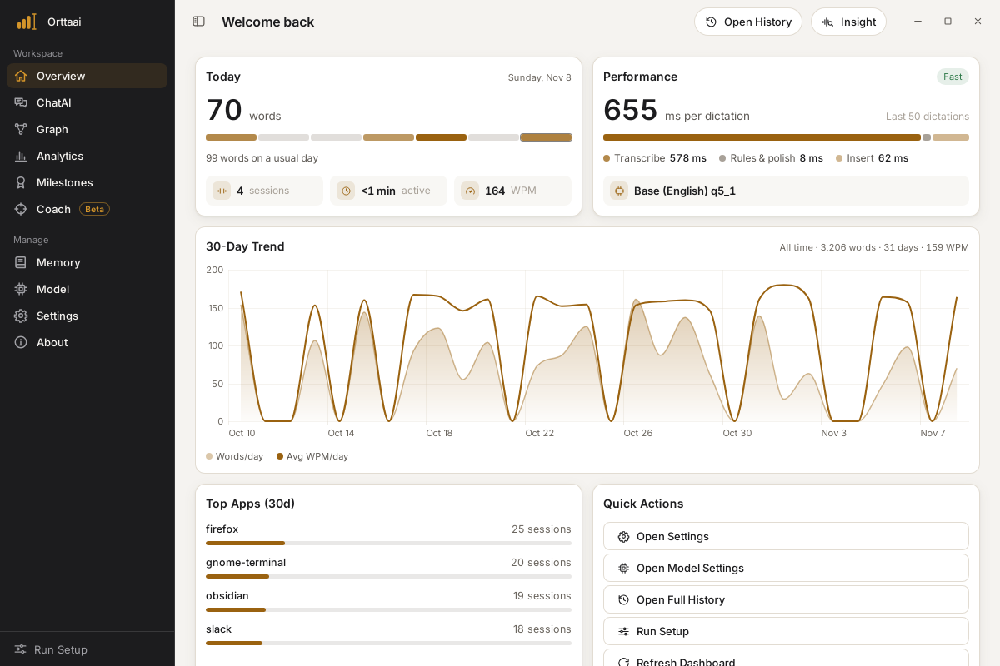
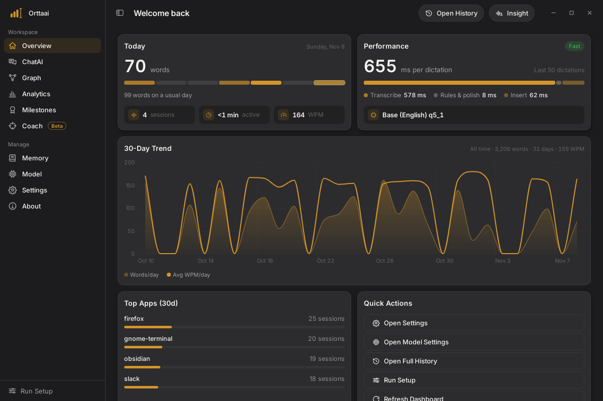
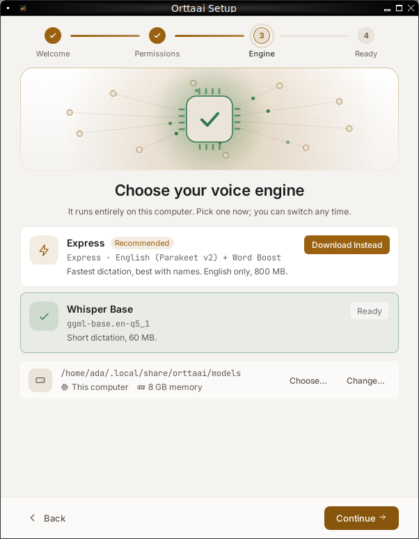
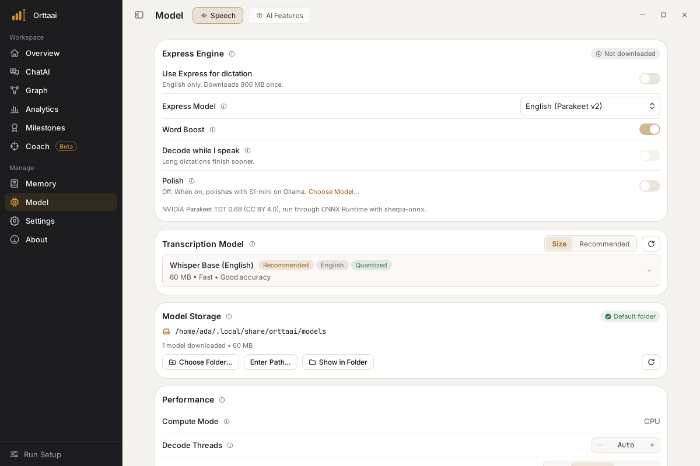
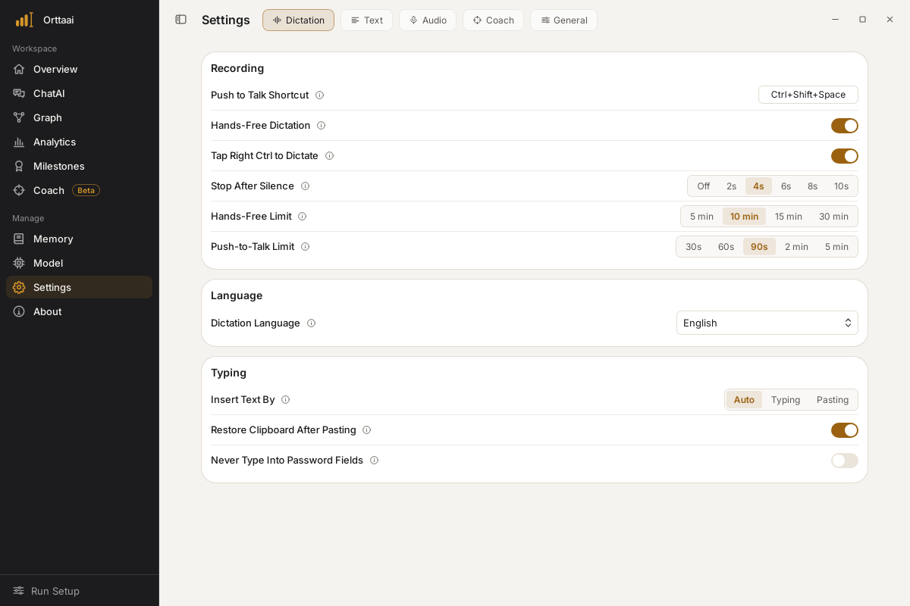
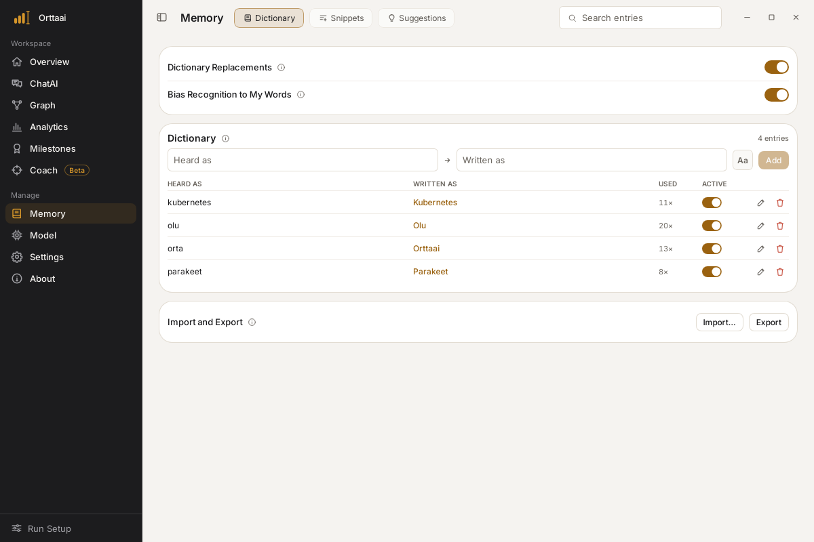
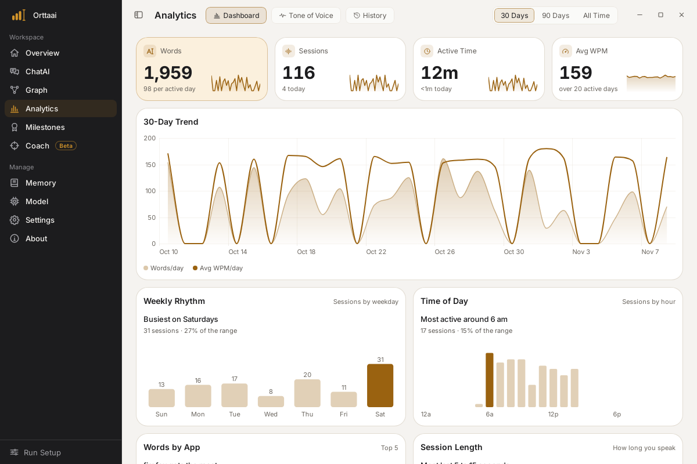
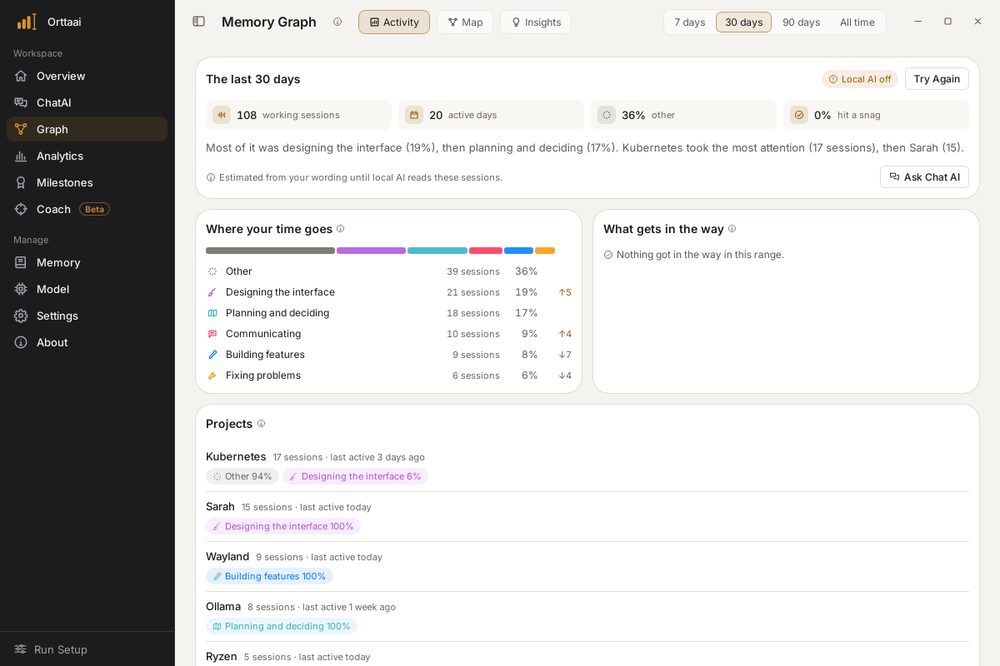
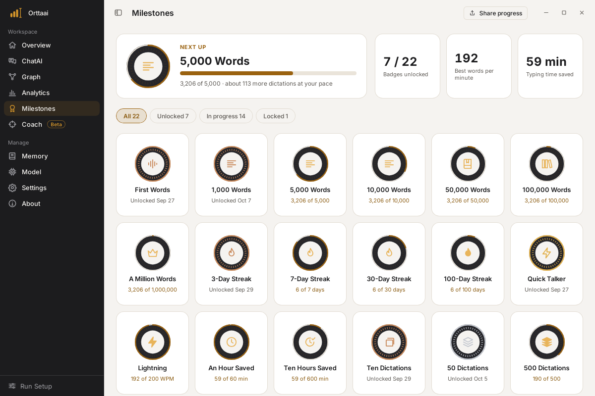

# Orttaai for Linux & Windows

**Cross-platform voice keyboard. Press a hotkey, speak, and your words appear at the cursor — in any app. 100% on-device.**

This is a standalone Rust + Tauri reimplementation of [Orttaai](https://github.com/theoyinbooke/orttaai) (the native macOS app) for **Linux and Windows**. The macOS app is a separate project and is not affected by this one.

## Screenshots



|  |  |
| --- | --- |
| **Dark mode**: every page follows your system or your choice<br> | **First-run setup**: pick Express or Whisper; the download shows in its own card<br> |
| **Model**: Express with Word Boost, Whisper models, where models are kept<br> | **Settings › Dictation**: hold or tap your shortcut, or tap Right Ctrl<br> |
| **Memory**: dictionary words and snippets, applied to every dictation<br> | **Analytics**: words, sessions, rhythm and the apps you dictate into<br> |
| **Graph**: where your dictation time goes, by topic and project<br> | **Milestones**: 22 badges, with share cards<br> |

## Architecture

A **write-once Rust core** + a **disposable Tauri UI shell**. Every OS-specific behavior (audio, text injection, global hotkey) lives behind a trait, so a change in one platform never forces a rewrite elsewhere.

```
app/   Tauri 2.x shell (web UI)        ← added in Phase 2
core/  orttaai-core (Rust, no GUI deps) ← the durable engine
cli/   headless dictation tool          ← Phase 0/1 deliverable
```

See [`docs/architecture.md`](docs/architecture.md) and the full build plan for details.

## Status

**v0.3.0 — macOS feature parity.** The desktop app now mirrors the native Mac app
(v1.18), screen for screen. See [`docs/parity.md`](docs/parity.md) for the full map.

- **Dictation** — hold the shortcut to talk, or **tap it for hands-free** (stops on the
  next tap, the pill's stop button, **silence** via Silero VAD, or its time cap, with a
  countdown). Optionally **tap Right Ctrl** on its own to start and again to insert
  (Windows and X11). Mic picker with Bluetooth/disconnect recovery that keeps what was heard.
  Paste or type, clipboard restored (images too). A pill with live waveform and timer
  shows only while you dictate, just above the taskbar on Windows. On Windows a **click
  on the tray icon** starts and stops dictation.
- **Two speech engines** — **Whisper** (whisper.cpp, every language, optional CUDA) and
  **Express** (**Fluid Speech Mini**, the Mac's Express model, via ONNX Runtime — the fastest option on CPU; NVIDIA **Parakeet** v3 for other languages).
- **Learn from your edits** — fix a misheard name right after dictating it and Orttaai
  suggests it for your dictionary (UI Automation on Windows, AT-SPI on Linux).
- **Text pipeline** — dictionary (multi-word, case-sensitive), fuzzy dictionary,
  snippets, filler/stutter removal, spoken formatting ("new line", lists), automatic
  paragraphs, number formatting, style modes, vocabulary bias.
- **Local AI** (Ollama or LM Studio, local endpoints only) — **Polish** (S1-mini or any
  model), **voice edit** of the selected text (or of your last dictation; say an
  instruction on the dictation shortcut, or **tap Right Shift**), **Chat AI** over your own dictations
  (streaming, saved conversations), **Writing Insights**, **Tone of Voice**.
- **Memory Graph** — semantic index of your dictations: Activity, concept Map, Insights.
- **Analytics**, **History** (search/filter), **Milestones** + share cards, **Coach**
  (speaking tracks, scenes, voice shape, month report), **What's New**.
- **Setup wizard**, tray menu, launch at login, single instance, signed auto-updates.

Not portable from the Mac: iCloud/CloudKit sync with the iPhone keyboard, Apple
Intelligence polish, and the CoreML coach voices (the WebView's speech voices are used).

## Install

Download the installer for your platform from the
[**latest release**](https://github.com/theoyinbooke/orttaai-desktop/releases/latest):

| Platform | File |
|---|---|
| **Linux** — AppImage (portable) | `Orttaai_<version>_amd64.AppImage` |
| **Linux** — Debian / Ubuntu | `Orttaai_<version>_amd64.deb` |
| **Linux** — Fedora / RHEL | `Orttaai-<version>-1.x86_64.rpm` |
| **Windows** — installer (.exe) | `Orttaai_<version>_x64-setup.exe` |
| **Windows** — MSI | `Orttaai_<version>_x64_en-US.msi` |

```bash
# Linux — AppImage (no install needed)
chmod +x Orttaai_*_amd64.AppImage && ./Orttaai_*_amd64.AppImage

# Linux — Debian/Ubuntu
sudo apt install ./Orttaai_*_amd64.deb

# Linux — Fedora/RHEL
sudo dnf install ./Orttaai-*-1.x86_64.rpm
```

On **Windows**, run the `.exe` (or `.msi`) and follow the installer.

Then: open the **Models** tab → download a Whisper model (the quantized **Q5** tiers
are fastest) → **Dictate → Start**, and press the push-to-talk shortcut (default
**Ctrl+Shift+Space**) to dictate into any app.

**Auto-update:** installed builds check for updates **automatically on launch** and
install the signed update (you can also trigger it from *Settings → Check for updates*).

> **GPU:** the default download is a **portable CPU build** — compiled for an AVX2 baseline,
> so it runs on every x86-64 CPU since ~2013 and never crashes on CPUs without AVX-512 (see
> _Releases_ below). On **NVIDIA**, grab the separate **`*-cuda`** download (or build
> `--features cuda` yourself) for ~5–15× on medium/large models — needs the NVIDIA driver at
> runtime. See [`docs/performance.md`](docs/performance.md). _(Cross-vendor Vulkan is pending an
> upstream whisper-rs fix — its 0.16 bindings reference ggml symbols the bundled whisper.cpp
> removed.)_
>
> **Linux runtime notes:** dictation captures the mic (PipeWire/ALSA) and types via the
> XDG **RemoteDesktop portal** on Wayland (grant the one-time prompt) or `wtype`/X11.
> See [`docs/gaps.md`](docs/gaps.md).

## Build

```bash
cargo build           # OS-agnostic core + CLI (mock backends)
cargo test            # unit tests
cargo run -p orttaai-cli -- demo   # run the dictation loop with mock backends
```

### Desktop app (Tauri)

```bash
cd app
npm install
npm run tauri dev     # launch the desktop window
```

> Linux build deps for Tauri: `libwebkit2gtk-4.1-dev libgtk-3-dev
> libayatana-appindicator3-dev librsvg2-dev libxdo-dev`. `app/src-tauri` is its own
> Cargo workspace, so the heavy webview build stays out of the core/cli checks.

### Real transcription (whisper.cpp)

```bash
# tiny English model (~75 MB); models/ is git-ignored
mkdir -p models
curl -L -o models/ggml-tiny.en.bin \
  https://huggingface.co/ggerganov/whisper.cpp/resolve/main/ggml-tiny.en.bin

# transcribe a 16 kHz mono WAV
cargo run -p orttaai-cli --features whisper -- \
  transcribe models/ggml-tiny.en.bin path/to/audio.wav
```

> Building `--features whisper` compiles whisper.cpp via cmake (needs a C/C++ toolchain).
> GPU acceleration is a build flag, not a code change: enable whisper-rs's `cuda` /
> `vulkan` / `metal` / `hipblas` features per target.
>
> Known cosmetic follow-up: whisper.cpp logs to stderr; the transcript itself prints
> cleanly to stdout. We'll route those logs through `tracing` when the app shell lands.

### Microphone capture (cpal)

```bash
# list input devices
cargo run -p orttaai-cli --features audio -- devices

# record 5s from the mic and transcribe it (full mic → whisper pipeline)
cargo run -p orttaai-cli --features "audio whisper" -- \
  record 5 models/ggml-tiny.en.bin
```

> Building `--features audio` needs ALSA headers on Linux (`libasound2-dev`); macOS
> and Windows need nothing extra.
>
> **macOS note:** capturing (and even *enumerating*) the microphone is gated behind
> the system privacy prompt. Grant your terminal microphone access in
> *System Settings → Privacy & Security → Microphone* before running `record`/`devices`,
> or the call will block waiting for permission.

### Text injection (enigo / wtype)

```bash
# Linux build dep: libxdo-dev (enigo's X11 backend); Wayland uses `wtype` at runtime.
cargo run -p orttaai-cli --features injection -- inject "hello from orttaai"
```

> `inject` waits 2 s so you can focus a target window, then types the text.
> Backends: Windows `SendInput`, macOS `CGEvent`, Linux X11 via `enigo`, Linux
> Wayland via `wtype` (install it). On macOS, grant **Accessibility** permission to
> your terminal (*System Settings → Privacy & Security → Accessibility*).
>
> Secure/password-field detection is not reliable on Linux, so it is reported as
> `Unknown` and injection is **not** blocked there — see [`docs/gaps.md`](docs/gaps.md).

### Full dictation loop (the Phase-0 spike)

The real end-to-end loop, ready to run on Linux & Windows:

```bash
# needs ALSA + libxdo on Linux; a model on disk; mic + accessibility permissions
cargo run -p orttaai-cli --features full -- dictate models/ggml-tiny.en.bin
```

Hold the push-to-talk chord (default **Ctrl+Shift+Space**), speak, and release — the
transcript is typed into the focused window. This is the Phase-0 spike gate from the
build plan: *hold hotkey → speak → text appears*.

> **Wayland:** global shortcuts and typing go through the XDG GlobalShortcuts and
> RemoteDesktop portals (falling back to `wtype`). **macOS** (dev host only): the
> hotkey needs a main-thread run loop, so `dictate` is intended for Linux/Windows.

### Windows builds: static C runtime

The Express engine links sherpa-onnx's prebuilt ONNX Runtime, which is built with the
static C runtime (`/MT`). `.cargo/config.toml` makes Rust use `+crt-static` on Windows;
whisper.cpp must match, so **dot-source `scripts/windows-crt-env.ps1` before building
on Windows** (CI does this). Cross-builds use `scripts/windows-crt-env.sh`.

## Platform support targets

| | Audio | Injection | Global hotkey | Notes |
|---|---|---|---|---|
| **Windows** | WASAPI (`cpal`) | `SendInput` (`enigo`) | `RegisterHotKey` | Easiest target — all solid |
| **Linux X11** | ALSA/Pipe (`cpal`) | `xdotool` | `XGrabKey` | Reliable |
| **Linux Wayland** | PipeWire (`cpal`) | `wtype` | XDG portal | Brittle hotkey; see gaps doc |

## Troubleshooting log

If Orttaai crashes or shows an error you want to report, you can turn on a
diagnostic log. Quit Orttaai, then start it with `ORTTAAI_LOG=info` set:

- **Windows (PowerShell):** `$env:ORTTAAI_LOG="info"; & "$env:LOCALAPPDATA\Orttaai\Orttaai.exe"`
- **Linux:** `ORTTAAI_LOG=info orttaai`

The log is written to `orttaai.log` in Orttaai's data folder
(`%APPDATA%\orttaai\Orttaai\data` on Windows, `~/.local/share/orttaai` on Linux).
Attach it to your bug report.

**The log never contains your dictations or your data.** It does not record what
you say or type, your transcripts, dictionary, snippets, clipboard or selected
text. It holds only technical events, such as the engine starting, models
loading, audio device changes, timings and error messages, that help us
troubleshoot a crash or an error. Your home folder is written as `~`, so file
paths don't show your account name. The same note is written at the top of the
file, and the log stays on your computer unless you choose to send it.

## Known OS-level gaps

Secure/password-field detection is unreliable on Linux, Wayland global hotkeys are brittle, and there is no Apple-Neural-Engine-class acceleration. See [`docs/gaps.md`](docs/gaps.md).

## Releases, installers & auto-updates

`.github/workflows/release.yml` builds signed installers for every platform via
[`tauri-action`](https://github.com/tauri-apps/tauri-action):

- **Linux:** `.AppImage`, `.deb`, `.rpm`
- **Windows:** `.exe` (NSIS) and `.msi`

**Portable CPU builds.** The release sets `GGML_NATIVE=OFF` so whisper.cpp compiles for an
**AVX2 + FMA + F16C + BMI2** baseline instead of the runner's native ISA. This is essential:
GitHub's runners are AVX-512-capable Xeons, and the ggml default (`-march=native`) would bake
in AVX-512 and crash with an illegal instruction (SIGILL) on the many consumer CPUs without it.
See [`docs/performance.md`](docs/performance.md) › _Portable release builds_.

**Cut a release:**

```bash
# 1. bump the version in ALL of these (keep them in sync):
#      app/src-tauri/tauri.conf.json   ("version")
#      app/src-tauri/Cargo.toml        ([package] version)
#      app/package.json                ("version")
#      Cargo.toml                      ([workspace.package] version)  ← core + cli
# 2. tag and push
git tag v0.2.1 && git push origin v0.2.1
```

CI builds each platform **sequentially** (`max-parallel: 1`) into a **draft** release —
serialized so the per-platform merge into `latest.json` can't race — signs the updater
artifacts, and a final `publish-release` job flips the draft to **published** atomically once
every platform has uploaded. The `releases/latest/download/latest.json` endpoint only resolves
to the published release, so the app never sees a half-built one.

**GPU (CUDA) builds** are decoupled in `.github/workflows/release-cuda.yml` (manual dispatch):
*Actions → release-cuda → Run workflow → tag*. It builds `--features cuda` and uploads `*-cuda`
assets to that release. CUDA builds are intentionally **not** in `latest.json` — the
auto-updater stays on the portable CPU build; NVIDIA users grab the `-cuda` download manually.

**Updater signing secrets** (already configured; the signing key was generated with
`tauri signer generate` and its public key is committed in `tauri.conf.json` — do **not**
regenerate it, or already-installed builds will reject updates):

| Secret | Value |
|---|---|
| `TAURI_SIGNING_PRIVATE_KEY` | contents of the private key file (kept out of the repo) |
| `TAURI_SIGNING_PRIVATE_KEY_PASSWORD` | the key password (empty if none) |

**Auto-updates:** the app checks **automatically on launch** (and from *Settings → Check for
updates*) via `@tauri-apps/plugin-updater`, fetching `releases/latest/download/latest.json` and
installing the signed bundle for the current platform, then relaunching. The repository's
Releases must be **public** for the default endpoint to be reachable.

## License

[MIT](LICENSE)
